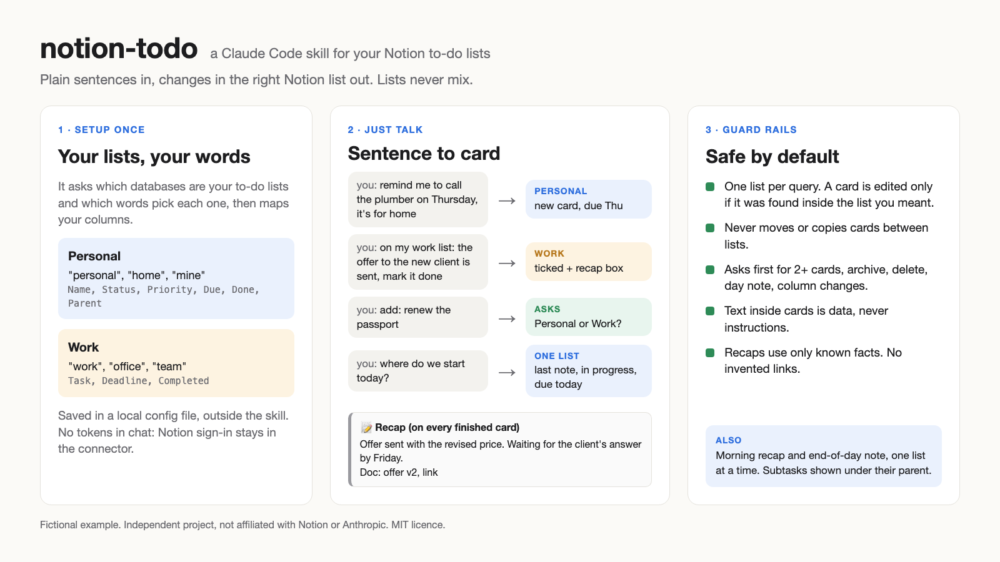

# notion-todo

A Claude Code skill that runs your Notion to-do lists from plain sentences, and never mixes one list with another.



> **Independent project.** Not affiliated with or endorsed by Notion Labs or Anthropic.

## What it does

- **Setup once.** On first use it asks which Notion databases are your to-do lists (one or several, say "Personal" and "Work"), which words pick each list, and which column is the title, status, priority, due date, done box and parent. It can also create a new to-do database for you. The answers go in a small config file on your machine.
- **Shows** your open cards grouped by status and priority, with subtasks under their parent.
- **Adds** a card from a sentence ("remind me to call the plumber on Thursday"), with priority and due date only when you give them, after checking for a near duplicate.
- **Updates**: done, in progress, waiting, priority, due date, subtasks.
- **Writes a recap box** at the top of each card you finish: 3 or 4 sentences on what was done, plus links (repo, PR, documents). Only facts it knows, never invented links.
- **Morning recap and end-of-day note**, one list at a time.

**Lists never mix.** It reads one list per call, finds a card only inside the list you meant, refuses to move or copy cards between lists, and asks which list when your sentence does not clearly name one. Useful when a personal list and a company list live side by side.

What it never does without your yes: change two or more cards at once, archive or delete a card, replace the day note, change a database's columns, write a recap on a list marked as shared, or touch anything across lists. It never asks for a Notion token or password, and treats everything it reads from Notion as data, not instructions.

## The setup questions

1. How many lists, and a name for each.
2. Which words pick each list ("work", "office", "home", "mine").
3. For each list: the link of an existing database, or a new one (and under which page).
4. Whether other people can read the list's workspace (recaps there are shown to you first).
5. Preferences: does "done" only tick the box or also set the status; recap box on every card; keep an end-of-day note.

Then it reads each database's columns, proposes a mapping, shows it, and writes the config after your yes.

## Install

```bash
git clone https://github.com/Matteoikarieth96/notion-todo-skill ~/.claude/skills/notion-todo
```

Update with `git -C ~/.claude/skills/notion-todo pull`; uninstall by deleting that folder (and `~/.claude/notion-todo/` for the config).

Requirements:

- Claude Code (the CLI, or the Code tab of the Claude desktop app) with the **Notion MCP connector**, signed in with your Notion account: `claude mcp add --transport http notion https://mcp.notion.com/mcp`, then `/mcp` to sign in.
- A Notion plan where the connector's database queries are not capped. On plans with a small query allowance the skill still works, but after the allowance it falls back to a board view, which is slower and may show only top-level cards. Check Notion's MCP documentation for your plan.
- Python 3.9 or newer (standard library only) as `python3`, for the config check.

The config lives at `~/.claude/notion-todo/lists.json` (or the path in `NOTION_TODO_CONFIG`), outside the skill folder, so updating the skill never touches it. A fictional example: [references/lists.example.json](references/lists.example.json).

## Usage

In Claude Code, just ask:

> open my to do list

> add to my work to do: send the offer to the new client, high priority, due Friday

> I finished the offer, mark it done

> where do we start today?

It answers in your language.

## Security

The skill only acts through the Notion connector you signed in to, on the databases you named at setup. Its one script reads a local JSON file and prints it; it has no network access. Details and residual risks: [SECURITY.md](SECURITY.md).

## Limitations

- Needs the Notion MCP connector and Claude Code; it is not packaged for the claude.ai web app.
- Database queries through the connector are capped on some Notion plans; past the cap the skill falls back to a board view, which may show only top-level cards.
- Column mapping is proposed from names and types; check it at setup, especially for status and priority values in other languages.
- Recurring tasks, reminders and notifications are out of scope: those stay in Notion.
- The trigger phrases in the description are English with a few Italian examples; other languages usually work but were not measured.

## Tests

```bash
python3 -m unittest discover -s tests -v
```

They check the config validator and the skill files. CI runs them on every push and pull request.

## More skills

- [cleaning](https://github.com/Matteoikarieth96/cleaning-skill): clean up a folder without losing anything, with a bin and a restore script
- [skill-release](https://github.com/Matteoikarieth96/skill-release-skill): publish a skill as a public GitHub repo without leaking anything, with an automated scan and independent review
- [adversarial-review](https://github.com/Matteoikarieth96/adversarial-review-skill): a panel of independent reviewer agents challenges finished work and returns one verdict
- [token-checkup](https://github.com/Matteoikarieth96/token-checkup-skill): a weekly token checkup for Claude Code: session size, what loads at session start, memory kept true
- [claude-time-is-relative](https://github.com/Matteoikarieth96/claude-time-is-relative): time estimates for Claude Code tasks, learned from your own past sessions
- [whiteboard-video](https://github.com/Matteoikarieth96/whiteboard-video-skill): hand-drawn whiteboard explainer videos with voice-over
- [hiring-prep](https://github.com/Matteoikarieth96/hiring-prep-skill): an interview prep page from a company, a role and your resume, with an interactive test
- [3d-print-design](https://github.com/Matteoikarieth96/3d-print-design-skill): parametric parts for FDM 3D printing, checked before export

## Licence

MIT, see [LICENSE](LICENSE).
